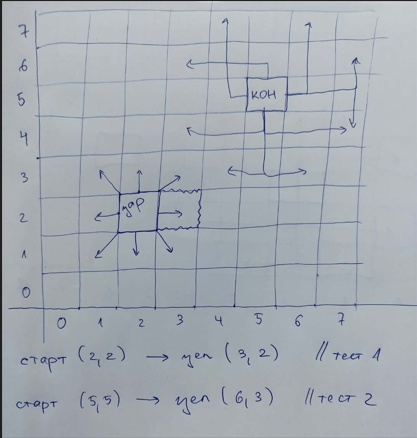

# Седмица 2 - Булев тип. Условни оператори

## Бележки по темата

### Булев тип

- само две стойности - `true`, `false`
- ненулево число се преобразува до `true`
- нулата се преобразува до `false`

### Логически оператори

- `&&` - конюнкция
- `||` - дизюнкция
- `!` - отрицание

### Закони на де Морган

- `!(A && B)` <-> `!A || !B`
- `!(A || B)` <-> `!A && !B`

### Оператори за сравнение

- `<,>,<=,=>,==,!=`

### Интересен синтаксис на switch
- по номер на ден от седмицата да се върне дали ще го прекараме във фми или не

    ```c++
    int day = 6;
    switch (day) {
        case 1: case 2: case 3: case 4: case 5:
            std::cout << "FMI";
            break;
        case 6: case 7:
            std::cout << "Home. Optional...";
            break;
        default:
            std::cout << "invalid day";
            break;
    }
    ```

### Примери

1. Да се напише булев израз, който има стойност true, когато условието е в сила, и стойност false в противен случай.
-	цялото число x дава остатък 3 при деление на 5
-	цялото число x е в интервала `[-4, 3)`
-	цялото число x е в интервала `(-10, -1] U (4,7) U [10,+inf)`
-	поне едно от числата а, b, c е четно. Прилагайки закона на де Морган към получения булев израз, какво условие се получава?

2. Да се напише булев израз, който има стойност true, когато условието е в сила, и стойност false в противен случай.
- символ е малка латинска буква
- символ е голяма латинска буква
- символ е буква
- символ е цифра

*Насоки:* 
- символ се представя в паметта чрез число
- разгледайте някоя ASCII таблица
- за да решите задачата, не е нужно да знаете кодовете
- защо следният израз не е коректен?

    ```c++
    char s = 'F';
    bool isLetter = 'A' <= s && s <= 'z';
    ```

3. Разгледайте таблиците на истинност на && и ||. За кои стойности на левия аргумент няма смисъл да се пресмята десният? Проучете в кои случаи това е от голямо значение в програма на c++.

### Как се извежда на стандартния изход текст на кирилица на Windows?

```c++
#include <iostream>
#include <windows.h>

int main() {
    SetConsoleOutputCP(CP_UTF8);
    std::cout << "Здравейте! Аз съм от България!";
    return 0;
}
```

**Бележка:** Това е само за информация. Добре е имена на променливи, функции, коментари да бъдат на английски език, за да се разбират от всички програмисти.

## Задачи

Задача 1: Напишете програма, която по подадено число извежда на конзолата следните резултати:
-   Ако числото се дели на 3 -> извеждаме "Fizz"
-	Ако числото се дели на 5 -> извеждаме "Buzz"
-	Ако числото се дели на 3 и на 5 -> извеждаме "FizzBuzz"
-	Ако не се дели нито на 3, нито на 5 -> извеждаме числото

Задача 2: На вход се подават 3 дробни числа страни на тригъгълник. Проверете дали това са страни на валиден триъгълник.

Задача 3. На вход се подават две цели числа, представляващи координати на точка в декартова координатна система. Проверете в кой квадрант се намира точката.

**Бонус:** точката може да лежи на някоя от координатните оси.

Задача 4: По подадени реални коефициенти на квадратно уравнение `ax^2 + bx + c = 0` проверете дали то отговаря на следните условия и изведете подходящо съобщение:
-	има реални корени
-	дали има двоен корен
-	дали има поне един цял корен
-	дали сбора на корените е различен от произведението им

*Насока:* Вижте в решението как се проверява дали 2 реални числа са равни 

Може да копирате кода от [тук](https://github.com/yoan-yordanov/Introduction-to-programming-2026-27/blob/main/week01%20-%20introduction/solutions.md)

Направете валидация на коефициентите на вход. Ако a = 0, да се изведе подходящо съобщение и програмата да приключи веднага.

Задача 5: Подава се на вход цяло число grade – оценка в шестобална система. Да се изведе „слаб, среден, добър, много добър, отличен“ на базата на оценката. Ако оценката е невалидна, да се изведе съобщение. Да се направи по два начина с if и switch.

Задача 6: Да се напише програма, която по въведено число от 1 до 12, задаващо месец, извежда в кой сезон на годината е този месец. (Сборник от задачи по програмиране на C++ Първа част, УП)

Задача 7: Умен съветник за облекло

Условие: Напишете програма, която дава съвети какво да облечете, базирано на три фактора:
-	Температура в градуси (цяло число).
-	Дали вали дъжд (true или false).
-	Дали духа силен вятър (true или false).

Правила:
-	При температура под 0°C -> задължително дебело яке и шапка. Ако вали -> добавете и чадър.
-	Между 0°C и 15°C -> леко яке. Ако духа вятър -> добавете ветроустойчиво горнище.
-	Над 15°C -> тениска. Ако вали -> чадър.

Задача 8: Да се напише програма, която по въведени 3 положителни числа, съответстващи на ден, месец, година, проверява дали датата е валидна. Годината е в диапазон [1000, 2100]. (Сборник от задачи по програмиране на C++ Първа част, УП)
<details>
<summary>Hint</summary>
Правило за високосна година:

- година, деляща се на числото 4 без остатък, е високосна;
- ако годината обаче също се дели без остатък на 100, то тя не е високосна;
- но ако годината също се дели без остатък и на 400, то тя пак ще е високосна.

</details>

**Бонус:** Следващият ден коя дата е?

Задача 9: Имаме шахматна дъска 8 на 8. Имаме само 3 фигури – цар, топ, кон.
Подават се две полета на дъската. Да се определи коя фигура може да се премести от едното до другото поле с един ход. (Сборник от задачи по програмиране на C++ Първа част, УП)

**Указание**: Шахматната дъска се представя чрез първия квадрант на декартова координатна система. Долният ляв ъгъл е нулата - координатното начало. Поле на дъската е двойка координати.



Тест1

Вход:

    2 2 3 2
    

Изход:

    цар
    топ

Тест2:

Вход:

    5 5 6 3
    

Изход:

    кон
    


